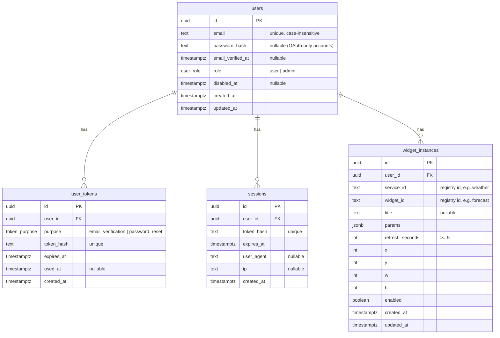

# Backend overview

All the backend code lives in **`apps/api/src/`**. It runs on **Bun**, uses
**Elysia** as the web framework (it handles the routes) and **Drizzle** to talk
to a **PostgreSQL** database.

## Where things are

```
apps/api/src/
├── server.ts          ← starts the server (app.listen)
├── app.ts             ← puts all the route groups together
├── config/env.ts      ← reads environment variables, crashes early if one is missing
├── db/
│   ├── schema.ts      ← the database tables, written in TypeScript
│   ├── client.ts      ← the database connection
│   └── migrate.ts     ← applies the SQL files in apps/api/drizzle/
├── plugins/           ← shared "middleware"
│   ├── session.ts     ← works out who is logged in from the cookie
│   ├── cors.ts        ← decides which websites may call the API
│   └── rate-limit.ts  ← stops spam
├── lib/               ← small helper tools
│   ├── password.ts    ← password hashing
│   ├── tokens.ts      ← random tokens and their hashes
│   ├── cache.ts       ← in-memory cache for widget data
│   ├── mailer.ts      ← sends emails (Brevo)
│   └── errors.ts      ← turns errors into clean JSON
├── services/          ← the "menu": Weather, GitHub, …
│   ├── types.ts       ← what a service or widget looks like
│   ├── registry.ts    ← the list of all services
│   ├── register.ts    ← fills the list when the server starts
│   └── definitions/   ← one file per service (mock.ts for now)
└── modules/           ← the actual API features
    ├── auth/
    ├── catalog/
    ├── dashboard/
    └── about/
```

## How a request travels

Take `GET /api/dashboard/instances` as an example:

1. **`server.ts`** starts the app, which **`app.ts`** built. `app.ts` groups
   every route under `/api` and adds CORS and the error handler.
2. The **`session.ts`** plugin reads the `session` cookie, hashes it and looks
   for that hash in the `sessions` table. If it finds a match, it knows who the
   user is. If not, the request gets a 401.
3. The request reaches the right **module**. Each module is split into three
   layers:

| File | Job | Kitchen version |
|---|---|---|
| `*.routes.ts` | Defines the URL, checks the request body is valid, sends the response | The waiter |
| `*.service.ts` | The logic ("does this widget exist?", "is refresh ≥ minimum?") | The chef |
| `*.repo.ts` | The only layer that touches the database | The fridge |

The `*.fakes.ts` files are fake repos for tests. They let tests run the chef's
logic without a real database.

## Endpoints

**`modules/auth/`**, which covers accounts:

| Method | Path | What it does |
|---|---|---|
| POST | `/api/auth/register` | Creates an account and sends a verification email |
| POST | `/api/auth/verify-email` | Confirms the email using the token from the mail |
| POST | `/api/auth/resend-verification` | Sends the verification email again |
| POST | `/api/auth/login` | Checks the password and sets the session cookie |
| POST | `/api/auth/logout` | Deletes the session |
| GET | `/api/auth/me` | Returns the logged-in user |

**`modules/catalog/`**, which covers what's available:

| Method | Path | What it does |
|---|---|---|
| GET | `/api/catalog` | Every service, its widgets and the settings each widget needs, built straight from the registry |

**`modules/dashboard/`**, which covers the user's own widgets:

| Method | Path | What it does |
|---|---|---|
| GET | `/api/dashboard/instances` | Lists my widgets |
| POST | `/api/dashboard/instances` | Adds a widget |
| PATCH | `/api/dashboard/instances/:id` | Changes one widget (title, settings, refresh time…) |
| DELETE | `/api/dashboard/instances/:id` | Removes it |
| PATCH | `/api/dashboard/layout` | Saves the new positions after you drag widgets around |
| GET | `/api/dashboard/instances/:id/data` | Returns the widget's actual data (see below) |

The data route lives in `data.service.ts`: it checks the cache, and on a miss
it calls the widget's `fetch()` and caches the result.

**`modules/about/`**:

| Method | Path | What it does |
|---|---|---|
| GET | `/about.json` | The file the Epitech subject requires. It's outside `/api` on purpose |

**Also available:** `GET /api/health` returns `{ ok: true }`. In development,
Swagger-style API docs are generated automatically by the `openapi` plugin in
`app.ts`.

## The database

The tables are defined in **`db/schema.ts`**. Drizzle turns them into SQL
migration files in `apps/api/drizzle/`, and `bun run migrate` applies them.

There are 4 tables, and everything hangs off `users`:



Every `user_id` is a foreign key to `users.id` with **cascade delete**, so
deleting a user deletes all of their stuff too.

**`users`** holds one row per person.
- `email` is unique, and the check ignores upper/lower case.
- `password_hash` can be **empty**, which is planned for "Login with Google"
  accounts (#12).
- `email_verified_at` stays empty until they click the link.
- `role` is `user` or `admin`.
- `disabled_at` lets an admin block an account.

**`user_tokens`** holds one-time codes that get emailed.
- `purpose` is `email_verification` or `password_reset`. The reset type already
  exists, ready for #11.
- `token_hash` stores **only the hash**, so the real token exists only inside
  the email.
- `expires_at` sets when the code stops working, and `used_at` makes sure it
  can only be used once.

**`sessions`** holds one row per logged-in browser.
- The cookie holds the raw token, and the database holds only `token_hash`.
  Someone who steals the database still can't log in as anyone.
- `expires_at` defaults to 30 days after login (`SESSION_TTL_DAYS`).

**`widget_instances`** holds one row per widget placed on someone's dashboard.
- `service_id` and `widget_id` are plain text, not links to another table.
  Services live in **code** (the registry), not in the database.
- `params` is JSON with the widget's settings, e.g. `{ "city": "Paris" }`.
- `refresh_seconds` must be at least 5; the database itself enforces this.
- `x, y, w, h` give the widget's position and size on the grid, and can't be
  negative.
- `title` is an optional custom name, and `enabled` turns the widget on or off.

### What's not in the database

- **Services and widget definitions** live in code, in `services/definitions/`.
- **Widget data** (the actual weather and so on) lives in memory in
  `lib/cache.ts` and is lost when the server restarts. That's fine, because it
  just gets fetched again.

### Coming next

#21 adds a 5th table, **`service_subscriptions`**. It's another child of
`users` and stores which services you've connected to and your **encrypted**
API keys.
